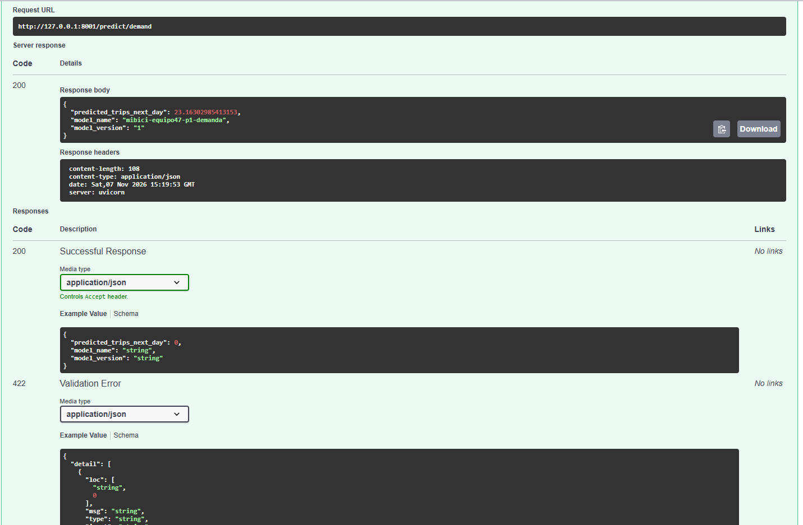

# Proyecto MiBici — Equipo 47

Proyecto integrador de Machine Learning para analizar los viajes del sistema de bicicletas públicas MiBici de Guadalajara, Jalisco. Incluye ingesta reproducible de datos, ingeniería de variables, experimentos de regresión, clasificación y clustering, seguimiento con MLflow y registro de modelos.

## 1. Objetivos del proyecto

El equipo aborda tres problemas de Machine Learning.

### P1. Regresión: predicción de demanda

Predecir el número de viajes que iniciará una estación durante el día siguiente, utilizando información histórica de viajes y variables temporales.

- **Unidad de análisis:** estación y día.
- **Variable objetivo:** `target_trips_next_day`.
- **Métricas:** MAE, RMSE y R².

### P2. Clasificación: riesgo aproximado de disponibilidad

Identificar estaciones con posible presión de disponibilidad de bicicletas o anclajes, utilizando los flujos de entradas y salidas y la capacidad registrada de la estación.

- **Unidad de análisis:** estación y día.
- **Variable objetivo:** `target_risk_station_next_day`.
- **Métricas:** accuracy, balanced accuracy, precisión, recall, F1 y ROC-AUC, cuando estén disponibles.

**Limitación importante:** el conjunto de datos utilizado no contiene el inventario histórico real de bicicletas ni la ocupación de anclajes. Por tanto, la etiqueta de riesgo es una aproximación basada en el flujo neto de viajes y la capacidad registrada; no representa una observación real de una estación vacía o llena.

### P3. Clustering: agrupación de estaciones

Agrupar estaciones según sus patrones de uso y características geográficas para identificar perfiles de comportamiento.

- **Unidad de análisis:** estación.
- **Algoritmo:** K-Means.
- **Número de grupos:** se compararon varios valores de `k`.
- **Métricas:** silhouette score, inercia y tamaños de los grupos.

## 2. Fuente y versión de los datos

Fuente oficial: [Datos abiertos de MiBici](https://www.mibici.net/es/datos-abiertos/).

La ingesta utiliza los CSV mensuales publicados en el portal y la nomenclatura de estaciones.

| Elemento | Configuración |
|---|---|
| Inicio del periodo | Enero de 2023 |
| Fin del periodo | Septiembre de 2026 |
| Meses procesados | 45 |
| Viajes procesados | 16,833,133 |
| Estaciones en la nomenclatura actual | 484 |
| Formato procesado | Parquet |
| Versión de datos | `mibici-2023-01_to_2026-09-stations-2026-09` |

Los datos originales y procesados se conservan localmente y no se suben a GitHub. El archivo `references/data_manifest.json` contiene metadatos, conteos y hashes SHA-256 para identificar la versión de los datos.

La ingesta distingue los formatos de fecha ISO y día/mes/año para evitar asignar viajes al mes incorrecto. En la validación se comprobó que los 45 archivos procesados no tuvieran fechas vacías ni registros fuera del mes correspondiente.

Algunos identificadores históricos de estaciones pueden no estar presentes en la nomenclatura de septiembre de 2026. Los flujos históricos se conservan; para P3 se utilizan las estaciones de la nomenclatura actual que cuentan con coordenadas.

## 3. Partición temporal

Para evaluar predicciones futuras sin mezclar aleatoriamente observaciones del pasado y del futuro, se utiliza la fecha objetivo de cada muestra (`target_date`).

| Conjunto | Periodo |
|---|---|
| Entrenamiento | Enero de 2023 – diciembre de 2025 |
| Validación | Enero – junio de 2026 |
| Prueba | Julio – septiembre de 2026 |

La validación se utiliza para comparar modelos y ajustar hiperparámetros. La prueba se reserva para la evaluación final. En P1 y P2, el objetivo corresponde al día siguiente de la información histórica usada para generar las variables. El conjunto de prueba no debe utilizarse para seleccionar modelos ni ajustar hiperparámetros.

## 4. Estructura del repositorio

```text
TC5061-Proyecto-Equipo47/
├── data/                         # Datos locales, excluidos de Git
│   ├── raw/
│   ├── interim/
│   └── processed/
│       ├── trips/
│       ├── stations/
│       ├── features/
│       └── predictions/
├── references/
│   └── data_manifest.json
├── docs/
├── models/
├── notebooks/
│   ├── reports/
│   ├── drift_report.html
├── reports/
│   ├── evidencias/
│   ├── figures/
│   ├── p1_candidate_results.csv
│   ├── p2_candidate_results.csv
│   └── p3_candidate_results.csv
├── mibici/
│   ├── config.py
│   ├── dataset.py
│   ├── features.py
│   └── modeling/
│       ├── train.py
│       ├── predict.py
│       ├── run_experiments.py
│       ├── run_candidates_p1.py
│       ├── run_candidates_p2.py
│       └── run_candidates_p3.py
├── tests/
├── MLproject
├── python_env.yaml
├── .gitignore
├── pyproject.toml
├── requirements.txt
├── Makefile
└── README.md
```

La estructura exacta puede variar según los cambios integrados por el equipo. Los datos, el entorno virtual, las credenciales, la base local de MLflow y los artefactos locales están excluidos de Git mediante `.gitignore`.

## 5. Requisitos del entorno

El entorno de desarrollo verificado utiliza Python 3.11.9, MLflow 3.17.1, PyArrow 25.0.1, NumPy 1.26.4, pandas 2.1.4, scikit-learn 1.5.2, matplotlib y pytest. Las dependencias están fijadas en `requirements.txt`; `python_env.yaml` define el entorno usado por MLflow Projects.

Los siguientes comandos están escritos para Windows y PowerShell.

### 5.1. Clonar el repositorio

```powershell
git clone https://github.com/angelftj-spec/TC5061-Proyecto-Equipo47.git
cd TC5061-Proyecto-Equipo47
```

### 5.2. Crear e instalar el entorno

```powershell
py -3.11 -m venv .venv
.\.venv\Scripts\python.exe -m pip install --upgrade pip
.\.venv\Scripts\python.exe -m pip install -r requirements.txt
```

Los comandos invocan explícitamente el Python del entorno `.venv`, por lo que no es necesario activar el entorno.

> **Nota sobre la reproducción:** los datos descargados, la base SQLite y los artefactos de MLflow no se incluyen en Git. La primera ejecución requiere acceso al portal de datos y generar localmente los archivos necesarios.

## 6. Reproducir la ingesta

El proyecto define un punto de entrada `ingest` en `MLproject`. Para ejecutar la ingesta mediante MLflow Projects desde la raíz del repositorio:

```powershell
.\.venv\Scripts\mlflow.exe run . --entry-point ingest --env-manager local
```

También se puede ejecutar directamente:

```powershell
.\.venv\Scripts\python.exe -m mibici.dataset
```

La ingesta utiliza el rango configurado en `mibici/config.py` y descarga los CSV que no existan localmente. Después:

1. Normaliza los nombres de las columnas y los formatos de fecha.
2. Procesa los viajes mensualmente.
3. Guarda los viajes y la nomenclatura en Parquet.
4. Registra conteos, rutas y hashes SHA-256 en `references/data_manifest.json`.

Para seleccionar un rango más pequeño, si se ejecuta el módulo directamente:

```powershell
.\.venv\Scripts\python.exe -m mibici.dataset `
    --start-month 2023-01 `
    --end-month 2023-03 `
    --station-month 2026-09
```

Para forzar la descarga de los archivos originales:

```powershell
.\.venv\Scripts\python.exe -m mibici.dataset --force-download
```

## 7. Generar las variables

Después de completar la ingesta, ejecutar:

```powershell
.\.venv\Scripts\python.exe -m mibici.features
```

El comando genera los siguientes archivos:

| Archivo | Contenido |
|---|---|
| `data/processed/features/daily_station_flows.parquet` | Viajes iniciados y terminados por estación y día |
| `data/processed/features/p1_regression.parquet` | Variables históricas y objetivo de regresión |
| `data/processed/features/p2_classification.parquet` | Variables y etiquetas aproximadas de riesgo |
| `data/processed/features/p3_clustering.parquet` | Perfiles de uso por estación |

Las variables históricas de P1 y P2 incluyen rezagos y medias móviles calculadas con días anteriores. Se debe conservar esta separación temporal al incorporar nuevos predictores.

## 8. Experimentos reproducibles con MLflow Projects

La configuración `MLproject` define los puntos de entrada para la ingesta, entrenamiento y ejecución de los candidatos. El experimento de seguimiento se llama `mibici-equipo47`; la URI local de seguimiento utiliza SQLite.

### 8.1. Ejecutar los baselines

Ejecutar los tres problemas:

```powershell
python -m mibici.modeling.run_experiments --question ALL --n-clusters 4
```

Ejecutar un problema específico:

```powershell
# P1: regresión
.\.venv\Scripts\mlflow.exe run . --entry-point train -P question=P1 --env-manager local

# P2: clasificación
.\.venv\Scripts\mlflow.exe run . --entry-point train -P question=P2 --env-manager local

# P3: clustering
.\.venv\Scripts\mlflow.exe run . --entry-point train -P question=P3 --env-manager local
```

Para especificar el número de grupos de P3:

```powershell
.\.venv\Scripts\mlflow.exe run . --entry-point train -P question=P3 -P n_clusters=4 --env-manager local
```

Los comandos suponen que los nombres de parámetros y los puntos de entrada coinciden con la versión de `MLproject` incluida en la rama. Si se modifica esa interfaz, debe actualizarse también esta documentación.

### 8.2. Ejecutar los candidatos

Los puntos de entrada para los scripts candidatos se definen en `MLproject`. Por ejemplo:

```powershell
.\.venv\Scripts\mlflow.exe run . --entry-point candidates_p1 --env-manager local --experiment-name mibici-equipo47
.\.venv\Scripts\mlflow.exe run . --entry-point candidates_p2 --env-manager local --experiment-name mibici-equipo47
.\.venv\Scripts\mlflow.exe run . --entry-point candidates_p3 --env-manager local --experiment-name mibici-equipo47
```

### 8.3. Baselines de referencia

| Pregunta | Modelo baseline | Métricas principales |
|---|---|---|
| P1 | `DummyRegressor(strategy="mean")` | MAE, RMSE, R² |
| P2 | `DummyClassifier(strategy="most_frequent")` | Accuracy, balanced accuracy, precisión, recall, F1 |
| P3 | `KMeans` con cuatro grupos | Silhouette score, inercia y tamaños de grupos |

Estos modelos establecen una referencia inicial y no representan necesariamente los modelos finales seleccionados. En P1, el baseline predice el promedio de los viajes del conjunto de entrenamiento. En P2, predice siempre la clase más frecuente y, en la ejecución inicial, no detectó las observaciones positivas de riesgo.

## 9. Comparación de modelos y resultados

Los CSV de resultados de candidatos se conservan en `reports/`. Las métricas de validación sirven para comparar candidatos; las métricas de prueba corresponden a la evaluación final y no deben mezclarse.

### 9.1. P1: predicción de demanda

Resultados de validación registrados para algunos candidatos:

| Modelo | MAE de validación |
|---|---:|
| Random Forest | 4.6565 |
| HistGradientBoosting | 4.8625 |
| Ridge | 6.4827 |

El modelo final registrado fue Random Forest. En el conjunto de prueba obtuvo MAE = 5.6339, RMSE = 10.9310 y R² = 0.9029. La diferencia entre validación y prueba debe interpretarse considerando que se trata de periodos temporales distintos.

### 9.2. P2: clasificación de riesgo

Resultados de validación de candidatos:

| Modelo | Accuracy | Balanced accuracy | Precisión | Recall | F1 | ROC-AUC |
|---|---:|---:|---:|---:|---:|---:|
| Random Forest | 0.7272 | 0.7500 | 0.6233 | 0.8998 | 0.7365 | 0.8372 |
| HistGradientBoosting | 0.7438 | 0.7567 | 0.6534 | 0.8415 | 0.7356 | 0.8387 |
| Logistic Regression | 0.7108 | 0.6995 | 0.6702 | 0.6253 | 0.6470 | 0.7881 |

El modelo final registrado fue HistGradientBoosting. En el conjunto de prueba obtuvo F1 = 0.6773, recall = 0.8150 y ROC-AUC = 0.7665. Aunque Random Forest obtuvo un F1 de validación ligeramente superior en la tabla de candidatos, HistGradientBoosting presentó una ROC-AUC de validación ligeramente mayor y mejor balanced accuracy. La elección final debe explicarse en el informe con los criterios de selección usados por el equipo; no debe afirmarse que fue el mejor candidato en todas las métricas.

### 9.3. P3: agrupación de estaciones

| k | Silhouette score | Inercia | Tamaño mínimo | Tamaño máximo |
|---:|---:|---:|---:|---:|
| 3 | 0.1542 | 13976.42 | 13 | 242 |
| 4 | 0.1528 | 12556.96 | 13 | 215 |
| 5 | 0.1449 | 11742.50 | 8 | 189 |
| 6 | 0.1348 | 11173.05 | 8 | 135 |
| 8 | 0.1365 | 10312.64 | 1 | 136 |

El modelo final registrado fue K-Means con `k=3`, con silhouette score de 0.1542 y tamaños de grupo de 229, 242 y 13 estaciones. El silhouette score es moderado-bajo, por lo que los grupos deben interpretarse como perfiles descriptivos y no como categorías naturales inequívocas.

## 10. Consultar MLflow

Iniciar la interfaz desde la raíz del repositorio:

```powershell
.\.venv\Scripts\mlflow.exe ui `
    --backend-store-uri sqlite:///mlflow.db `
    --host 127.0.0.1 `
    --port 5000
```

Abrir [http://127.0.0.1:5000](http://127.0.0.1:5000).

El experimento `mibici-equipo47` registra parámetros, métricas, etiquetas y artefactos. La base `mlflow.db` y los artefactos permanecen localmente; no deben subirse a GitHub.

### 10.1. Model Registry

Los tres modelos finales se registraron en MLflow Model Registry con el alias `champion`:

| Problema | Nombre registrado |
|---|---|
| P1 | `mibici-equipo47-p1-demanda` |
| P2 | `mibici-equipo47-p2-riesgo` |
| P3 | `mibici-equipo47-p3-grupos` |

El script de inferencia resuelve el alias `champion` y carga el modelo registrado. Para que funcione, deben existir localmente la base de MLflow, los modelos registrados y los archivos de características procesadas.

## 11. Ejecutar inferencia

Después de completar la ingesta, generar las características y registrar los tres modelos finales, ejecutar desde la raíz del repositorio:

```powershell
.\.venv\Scripts\python.exe -m mibici.modeling.predict
```

El programa valida las columnas requeridas, carga los modelos registrados y genera:

| Archivo | Descripción |
|---|---|
| `data/processed/predictions/p1_demand_predictions.csv` | Predicciones de demanda |
| `data/processed/predictions/p2_risk_predictions.csv` | Clasificación aproximada del riesgo por estación |
| `data/processed/predictions/p3_station_clusters.csv` | Asignación de estaciones a grupos |

Las predicciones son resultados del modelo; no constituyen garantías sobre la demanda ni observaciones reales de disponibilidad de bicicletas.

## 12. Pruebas automatizadas

Ejecutar las pruebas:

```powershell
.\.venv\Scripts\python.exe -m pytest
```


Las pruebas verifican la normalización de nombres, el mapeo de columnas de estaciones, la interpretación de fechas y el rango mensual. La ingesta también debe validarse mediante los hashes del manifiesto y las fechas de los Parquet.

Adicionalmente se implementaron pruebas para verificar el correcto funcionamiento de las principales funciones del módulo de experimentación. Las pruebas validan el filtrado de registros por periodos temporales, el manejo de conjuntos de datos vacíos, la generación de matrices de características de referencia y el cálculo correcto de métricas de clasificación, como accuracy, balanced accuracy, precision, recall y F1-score. Asimismo, se verificó la reproducibilidad del algoritmo de agrupamiento K-Means mediante el uso de una semilla fija, comprobando que las ejecuciones con los mismos datos y parámetros produzcan resultados consistentes. También se incluyeron casos negativos para comprobar que las funciones generen excepciones cuando reciben datos o configuraciones inválidas.

### 12.1. Chequeos básicos de seguridad

El repositorio incluye una revisión de seguridad mediante `pip-audit` para las dependencias y `Bandit` para el análisis estático del código Python.

**Instalación de herramientas:**

```powershell
.\.venv\Scripts\python.exe -m pip install pip-audit==2.10.1 bandit==1.9.4
```

**Ejecución de pruebas y verificación de dependencias:**

```powershell
.\.venv\Scripts\python.exe -m pip check
.\.venv\Scripts\python.exe -m pytest tests -v
```

**Auditoría de dependencias:**

```powershell
.\.venv\Scripts\python.exe -m pip_audit --local
```

**Análisis estático de seguridad:**

```powershell
.\.venv\Scripts\python.exe -m bandit -r mibici
```

Para generar los reportes JSON:

```powershell
New-Item -ItemType Directory -Force "reports\security" | Out-Null

.\.venv\Scripts\python.exe -m pip_audit --local -f json -o reports/security/pip-audit.json

.\.venv\Scripts\python.exe -m bandit -r mibici -f json -o reports/security/bandit.json
```

Las herramientas pueden finalizar con un código distinto de cero si detectan vulnerabilidades o patrones inseguros. En ese caso se deben revisar los hallazgos y no interpretar el resultado como un error de instalación.

**Resultados de referencia del 1 de noviembre de 2026:**

- PyTest: 20 pruebas aprobadas.
- pip-audit: 59 registros de vulnerabilidad en 7 dependencias.
- Bandit inicial: 9 hallazgos, incluidos 2 de severidad media.
- Bandit después de aplicar controles de validación de URLs: 7 hallazgos de severidad baja, 0 medios y 0 altos.
- Consulta al índice oficial de MiBici: exitosa.

Los hallazgos restantes y sus recomendaciones se documentan en [Security Review](reports/security/security-review.md). La auditoría debe repetirse después de actualizar dependencias o modificar código relevante.

## 13. Flujo de trabajo con GitHub

Los cambios deben integrarse mediante Pull Requests dirigidos a `main`, siguiendo las reglas de protección y revisión del repositorio.

Ejemplo de flujo de trabajo:

```powershell
git switch main
git pull origin main
git switch -c feat/descripcion-del-cambio
```

Después de implementar y probar los cambios:

```powershell
git status
git add README.md
git commit -m "Document reproducible MiBici workflow"
git push -u origin feat/descripcion-del-cambio
```

Abrir un Pull Request hacia `main` y solicitar la revisión de otro integrante. No subir los CSV originales, los Parquet, `.env`, `.venv`, la base local de MLflow ni los modelos serializados generados durante los experimentos.

## 14. Evidencias del proyecto

Las capturas de seguimiento y artefactos se conservan en `reports/evidencias/`, y las tablas de candidatos en `reports/`. Entre las evidencias previstas están la vista de runs, las comparaciones de experimentos, el detalle de una ejecución, los artefactos de evaluación de cada problema y los modelos registrados.

Las rutas de evidencia deben corresponder a los archivos realmente presentes en el repositorio. Las evidencias visuales complementan, pero no sustituyen, las métricas y los artefactos reproducibles de MLflow.

## 15. Limitaciones y próximos pasos

- La etiqueta de riesgo de P2 es una aproximación; no representa observaciones históricas reales de estaciones vacías o llenas.
- Los grupos de P3 son descriptivos y dependen de las variables utilizadas, incluidas las coordenadas geográficas.
- Las métricas de validación y prueba corresponden a periodos diferentes y deben reportarse por separado.
- La selección final de P2 debe justificarse con los criterios usados por el equipo, dado que Random Forest tuvo un F1 de validación ligeramente mayor que HistGradientBoosting.
- Debe comprobarse que las instrucciones de reproducción funcionen desde un clon limpio con las dependencias y los datos locales necesarios.


## 16. Despliegue del modelo P1 como API REST con Docker

**Para docentes y revisores:** consultar la sección 16.11 para reproducir la API desde un clon limpio, descargando el modelo desde GitHub Releases, sin necesidad de entrenar ni instalar MLflow.

### 16.1. Descripción del servicio

Se implementó una API REST con FastAPI para realizar inferencia en tiempo real utilizando el modelo de regresión P1 de MiBici, encargado de predecir la demanda de viajes iniciados al día siguiente.

El servicio utiliza el modelo registrado en MLflow Model Registry y lo ejecuta dentro de un contenedor Docker compatible con el estándar OCI.

**Tecnologías utilizadas:**

- Python 3.11.9
- FastAPI y Pydantic
- MLflow Model Registry
- scikit-learn
- Docker

**Modelo utilizado:**

| Propiedad | Valor |
|---|---|
| Nombre | `mibici-equipo47-p1-demanda` |
| Algoritmo | Random Forest Regressor |
| Versión utilizada en las pruebas | `1` |
| Alias de origen | `champion` |
| Variables de entrada | 21 |
| Formato de salida | JSON |

La versión 1 corresponde a una reproducción local del modelo final P1 del proyecto, registrada con los mismos hiperparámetros principales. El registro incluye la cobertura temporal y el hash del archivo de características utilizado.

### 16.2. Arquitectura

El flujo de despliegue es:

1. Recuperar una versión del modelo desde MLflow Model Registry.
2. Exportar sus artefactos mediante `scripts/export_model.py`.
3. Empaquetar la API y el modelo exportado dentro de una imagen Docker.
4. Iniciar el contenedor y cargar el modelo durante el arranque de FastAPI.
5. Recibir peticiones HTTP, validar las entradas con Pydantic y devolver predicciones JSON.

El modelo se carga una sola vez al iniciar la aplicación. Las peticiones posteriores reutilizan el modelo en memoria.

### 16.3. Requisitos

- Docker Desktop con soporte para contenedores Linux, o un motor Docker compatible.
- Python 3.11 para preparar los artefactos del modelo.
- Acceso al modelo registrado en MLflow o a los datos procesados necesarios para reproducirlo.
- Repositorio del Equipo 47.

Los comandos siguientes están escritos para Windows PowerShell.

### 16.4. Preparación del modelo

**Ruta recomendada para evaluadores:** utilizar el GitHub Release y seguir la sección 16.11. Las opciones siguientes son alternativas para desarrolladores con acceso al Registry local o al dataset.

El modelo final no se almacena directamente en GitHub. Los artefactos serializados y la base local `mlflow.db` están excluidos mediante `.gitignore`.

Para construir la imagen, primero debe existir el modelo exportado en:

`models/p1_serving/`

**Opción A: utilizar un Registry local existente**

Con el entorno Python configurado y el modelo registrado con alias `champion`, ejecutar:

```powershell
.\.venv\Scripts\python.exe -m scripts.export_model
```

El script descarga la versión registrada desde el Registry SQLite local y la guarda en `models/p1_serving/`, junto con sus metadatos de despliegue.

**Opción B: reproducir y registrar el modelo P1**

Si no se dispone del Registry original, se puede reproducir localmente el modelo a partir de:

`data/processed/features/p1_regression.parquet`

Este archivo no está incluido en GitHub. Debe obtenerse del pipeline de datos del proyecto o de un integrante autorizado del equipo.

Una vez disponibles las dependencias y las características:

```powershell
.\.venv\Scripts\python.exe -m scripts.train_register_p1
.\.venv\Scripts\python.exe -m scripts.export_model
```

El primer comando entrena y registra una reproducción local de P1, creando una versión en MLflow y asignando el alias `champion`. El segundo exporta los artefactos de esa versión.

La exportación no sobrescribe automáticamente un directorio `models/p1_serving/` existente; se debe revisar antes de repetirla.

**Importante:** un clon limpio del repositorio no contiene los datos procesados, la base MLflow ni el modelo serializado. Por ello, la construcción requiere obtener esos recursos o ejecutar el proceso de preparación previo.

### 16.5. Construcción de la imagen Docker

Desde la raíz del repositorio, después de exportar el modelo:

```powershell
docker build -t mibici-p1-api:1.0 .
```

El `Dockerfile` utiliza Python 3.11.9, instala las dependencias de `requirements-api.txt` y empaqueta la API junto con los artefactos exportados.

La imagen establece las variables:

- `MIBICI_MODEL_PATH=/app/models/p1_serving`
- `MIBICI_MODEL_VERSION=1`

La versión empaquetada en la imagen validada es la 1. Si se exporta otra versión, debe actualizarse el metadato de versión configurado en el Dockerfile.

### 16.6. Ejecutar el contenedor

```powershell
docker run -d --name mibici-api -p 8001:8000 mibici-p1-api:1.0
```

Verificar que está en ejecución:

```powershell
docker ps
```

El servicio queda disponible en:

- API: http://127.0.0.1:8001
- Swagger UI: http://127.0.0.1:8001/docs
- Health check: http://127.0.0.1:8001/health

Para comprobar su estado:

```powershell
Invoke-RestMethod -Uri http://127.0.0.1:8001/health
```

Respuesta esperada para la imagen validada:

```json
{
  "status": "ok",
  "model_name": "mibici-equipo47-p1-demanda",
  "model_version": "1"
}
```

Para detener y eliminar el contenedor cuando ya no se necesite:

```powershell
docker stop mibici-api
docker rm mibici-api
```

### 16.7. Endpoint de predicción

**POST `/predict/demand`**

Recibe un JSON con las 21 características del modelo P1, incluyendo actividad reciente, ubicación, capacidad, calendario, rezagos y promedios históricos.

Pydantic valida las entradas y rechaza peticiones incompletas o incorrectas mediante respuestas HTTP `422`.

El repositorio incluye una petición real de ejemplo en:

`examples/demand_request.json`

Para ejecutarla desde PowerShell:

```powershell
Invoke-RestMethod `
    -Uri "http://127.0.0.1:8001/predict/demand" `
    -Method POST `
    -ContentType "application/json" `
    -Body (Get-Content .\examples\demand_request.json -Raw) |
    Format-List
```

**Respuesta obtenida en la prueba con Docker:**

```json
{
  "predicted_trips_next_day": 23.16302985413153,
  "model_name": "mibici-equipo47-p1-demanda",
  "model_version": "1"
}
```

El valor es una estimación de viajes iniciados al día siguiente, no un conteo observado ni una garantía de demanda real.

### 16.8. Validación y pruebas

Se implementaron pruebas automatizadas para verificar:

- Disponibilidad del servicio mediante `/health`.
- Predicción con una petición válida.
- Rechazo de cantidades negativas.
- Rechazo de campos faltantes o desconocidos.
- Manejo de coordenadas nulas.
- Generación correcta del esquema OpenAPI.

Ejecutar la suite completa:

```powershell
.\.venv\Scripts\python.exe -m pytest tests/ -v
```

**Resultados de validación del 7 de noviembre de 2026:**

- 27 pruebas aprobadas, sin fallos.
- Imagen Docker construida correctamente.
- Contenedor ejecutado en Linux.
- Endpoint `/health` operativo.
- Endpoint `/predict/demand` respondió HTTP 200.
- Predicción local y predicción Docker idénticas para la misma entrada: diferencia absoluta de `0`.

**Evidencia de predicción ejecutada desde Docker:**



### 16.9. Estrategia de despliegue elegida

Se eligió la **inferencia en tiempo real mediante API REST**, ya que permite que una aplicación solicite predicciones individuales de demanda cuando las necesita.

Esta estrategia facilita la integración futura con aplicaciones web, dashboards u otros servicios. Además, el modelo permanece cargado en memoria, evitando repetir el entrenamiento o la carga en cada petición.

La API recibe las características previamente calculadas; la generación automática de variables históricas no forma parte de esta primera versión.

Para generar predicciones masivas de todas las estaciones cada día, una arquitectura de inferencia por lotes podría ser más eficiente. Esa alternativa puede incorporarse en futuras etapas del proyecto.

### 16.10. Limitaciones y próximos pasos

- El modelo exportado debe estar disponible antes de construir la imagen.
- Los datos de entrenamiento y la base local de MLflow no se publican en GitHub.
- La versión desplegada debe identificarse y actualizarse explícitamente cuando cambie el modelo.
- La API todavía no incorpora autenticación, monitorización de producción ni orquestación de microservicios.
- El servicio está preparado como primera versión desplegable para su posterior integración en una arquitectura de microservicios.


### 16.11. Reproducción completa desde un clon limpio mediante GitHub Release

**Procedimiento recomendado para el profesor y los integrantes del equipo.** Validado el **7 de noviembre de 2026** desde un clon independiente del PR #7. Permite ejecutar FastAPI en Docker sin entrenar, sin instalar MLflow, sin tener `mlflow.db` y sin descargar los archivos Parquet utilizados durante el entrenamiento.

**Requisitos:** Git, Windows PowerShell, Docker Desktop con contenedores Linux y conexión a Internet. La descarga se realiza con PowerShell, por lo que no hace falta instalar GitHub CLI.

**Paso 1 — Clonar el código del PR #7.** Mientras el PR permanezca abierto:

```powershell
git clone --branch feat/diego-fastapi-docker --single-branch https://github.com/angelftj-spec/TC5061-Proyecto-Equipo47.git
Set-Location .\TC5061-Proyecto-Equipo47
```

Después de que el PR se integre a `main`, basta con clonar el repositorio normalmente con `git clone https://github.com/angelftj-spec/TC5061-Proyecto-Equipo47.git`. Utilizar solo una alternativa y hacerlo desde una carpeta donde todavía no exista el clon.

**Paso 2 — Descargar el modelo.** El archivo del [GitHub Release `mibici-p1-model-v1`](https://github.com/angelftj-spec/TC5061-Proyecto-Equipo47/releases/tag/mibici-p1-model-v1) pesa aproximadamente 21.08 MB y contiene el modelo MLflow completo. El archivo `model.pkl` ocupa 72.4 MB descomprimido.

```powershell
New-Item -ItemType Directory -Force .\dist | Out-Null

Invoke-WebRequest `
    -Uri "https://github.com/angelftj-spec/TC5061-Proyecto-Equipo47/releases/download/mibici-p1-model-v1/mibici-p1-model-v1.zip" `
    -OutFile ".\dist\mibici-p1-model-v1.zip"
```

**Paso 3 — Verificar la integridad SHA256 del ZIP.** La huella publicada de este archivo es:

```text
82925710ddb70eb8dc09ad04d5c1f471bc8a007590f98d64e48f944eb9b04181
```

```powershell
$expectedHash = "82925710ddb70eb8dc09ad04d5c1f471bc8a007590f98d64e48f944eb9b04181"
$actualHash = (Get-FileHash ".\dist\mibici-p1-model-v1.zip" -Algorithm SHA256).Hash.ToLowerInvariant()

if ($actualHash -ne $expectedHash) {
    throw "SHA256 incorrecto: no cargar el modelo."
}

Write-Host "Integridad del ZIP verificada."
```

**Paso 4 — Extraer el modelo en la ruta que espera Docker.**

```powershell
New-Item -ItemType Directory -Force .\models\p1_serving | Out-Null

Expand-Archive `
    -Path ".\dist\mibici-p1-model-v1.zip" `
    -DestinationPath ".\models\p1_serving" `
    -Force

if (-not (Test-Path ".\models\p1_serving\MLmodel") -or
    -not (Test-Path ".\models\p1_serving\model.pkl")) {
    throw "Faltan archivos del modelo MLflow exportado."
}
```

La ruta correcta es `models/p1_serving/MLmodel`, sin carpetas intermedias adicionales. Los archivos exportados están excluidos de los commits por `.gitignore`, pero `.dockerignore` permite copiarlos durante la construcción de la imagen.

**Paso 5 — Construir y ejecutar la imagen.** Se utiliza el puerto `8002` para evitar interferir con otras instancias locales.

```powershell
docker build -t mibici-p1-api:1.0 .

docker run -d `
    --name mibici-api-evaluacion `
    -p 8002:8000 `
    mibici-p1-api:1.0
```

**Paso 6 — Verificar el servicio y enviar una predicción.**

```powershell
Invoke-RestMethod -Uri "http://127.0.0.1:8002/health"

Invoke-RestMethod `
    -Uri "http://127.0.0.1:8002/predict/demand" `
    -Method POST `
    -ContentType "application/json" `
    -Body (Get-Content ".\examples\demand_request.json" -Raw) |
    Format-List
```

Resultado observado en la prueba:

```text
status: ok
model_name: mibici-equipo47-p1-demanda
model_version: 1

predicted_trips_next_day: 23.16302985413153
model_name: mibici-equipo47-p1-demanda
model_version: 1
```

La documentación interactiva está en **http://127.0.0.1:8002/docs**. La [captura de evidencia](images/evidencia_api_docker.png) muestra el endpoint de predicción devolviendo HTTP 200.

Para finalizar la prueba, si ya no se necesita el contenedor:

```powershell
docker stop mibici-api-evaluacion
docker rm mibici-api-evaluacion
```

**Verificación desde un clon independiente:** inicialmente no existía `models/p1_serving/MLmodel`; después de descargar y extraer el ZIP publicado, la construcción Docker terminó correctamente y ambos endpoints respondieron con éxito. Docker reutilizó algunas capas de caché existentes en la máquina durante esta prueba, pero el código y los archivos del modelo procedían exclusivamente del clon y del Release.

**Procedencia, seguridad y limitaciones:** el modelo publicado corresponde a una **reproducción local** del Random Forest P1 final, registrado con el alias `champion` y versión local 1; no es una copia certificada del Registry compartido del equipo. El archivo se distribuye como *prerelease* académico. Los modelos `pickle`/`cloudpickle` solo deben cargarse desde una fuente confiable, ya que la deserialización puede ejecutar código. El Dockerfile fija manualmente `MIBICI_MODEL_VERSION=1`, que debe actualizarse cuando cambie el artefacto; `scripts/export_model.py` utiliza SQLite local, pero **no interviene en este procedimiento basado en GitHub Release**. Las pruebas locales documentadas no sustituyen una ejecución independiente de CI/CD.

## Referencias

MiBici. (s. f.). *Datos abiertos*. https://www.mibici.net/es/datos-abiertos/

MLflow. (s. f.). *MLflow documentation*. https://mlflow.org/docs/latest/

scikit-learn developers. (s. f.). *scikit-learn documentation*. https://scikit-learn.org/stable/
