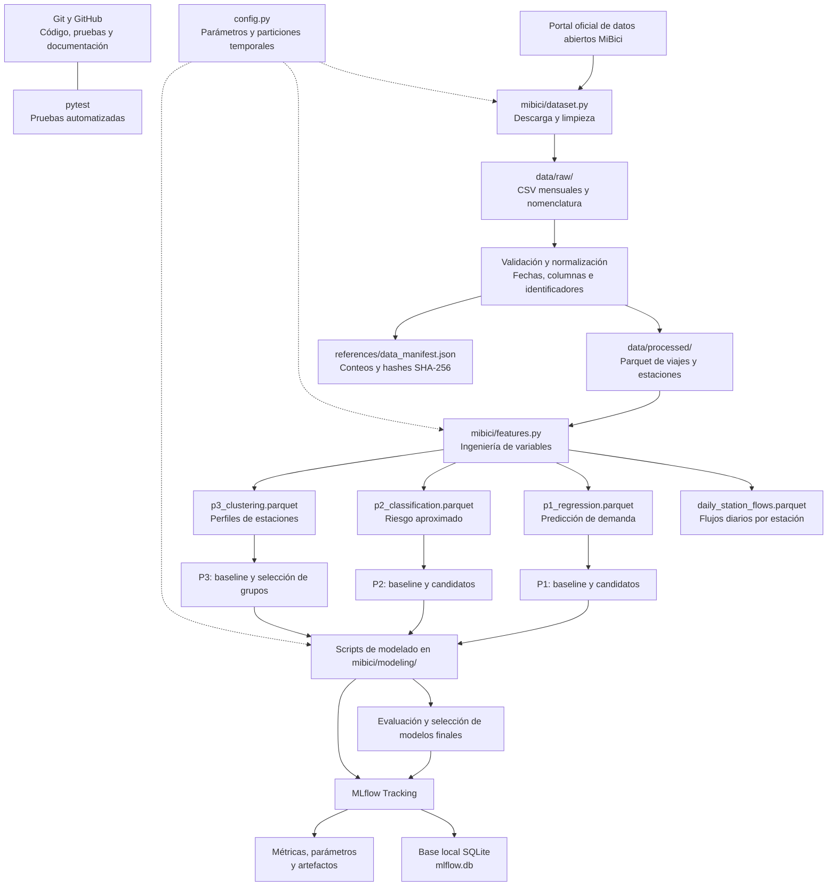

# Arquitectura del proyecto MiBici — Equipo 47

El flujo comienza con los datos abiertos de MiBici, continúa con la ingesta y transformación de los viajes, genera los conjuntos de datos para las tres preguntas de Machine Learning y registra los experimentos en MLflow.

## Componentes principales

| Componente | Responsabilidad |
|---|---|
| `dataset.py` | Descarga los archivos de origen, normaliza y limpia los datos. |
| `features.py` | Construye flujos diarios y variables para P1, P2 y P3. |
| `config.py` | Centraliza rutas, periodo de datos, versión y particiones. |
| `run_experiments.py` | Ejecuta experimentos baseline y tareas de modelado definidas para las preguntas del proyecto; registra resultados en MLflow. |
| MLflow | Conserva el historial de experimentos, métricas, parámetros y artefactos de evaluación y modelado. |
| Git y pytest | Apoyan el control de versiones y la validación automatizada. |

**Nota:** P2 utiliza una etiqueta proxy de riesgo basada en los flujos y la capacidad registrada; no representa un inventario histórico real de bicicletas o anclajes.
